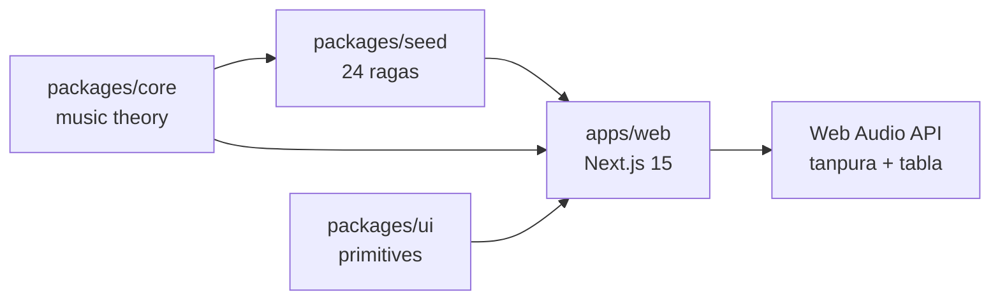
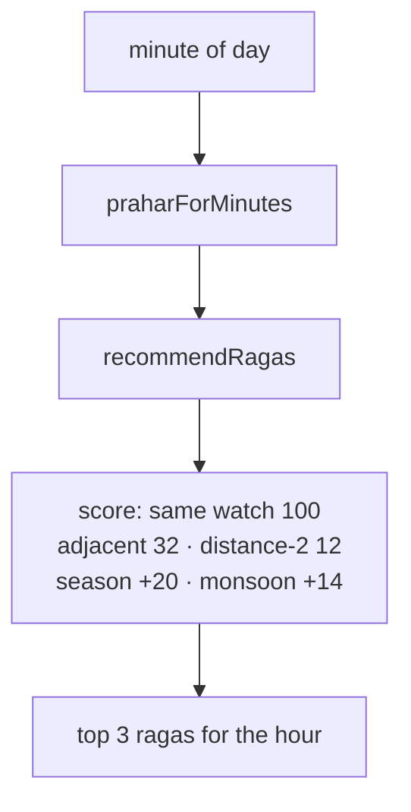
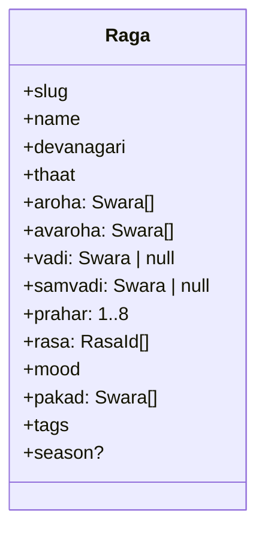

# Swarmandala

> The day has a scale.

A living atlas of Hindustani raga — twenty-four ragas, eight three-hour watches, a procedural tanpura, and a swara mandala you can play. No samples, no API keys, no backend. Everything you hear is synthesised in the browser with the Web Audio API.

**Live:** https://swarmandala-137gb333k-aniruddha-adaks-projects.vercel.app

## What's inside

- **Atlas** — twenty-four ragas, filterable by watch, thaat, mood, season. Each raga carries ascent, descent, pakad, vadi, samvadi, rasa, and a plain-language description.
- **Prahar clock** — eight three-hour watches from 4am. Drag the hand and the atlas re-tunes to the hour.
- **Raga detail** — a twelve-position swara mandala with the raga's ascent drawn across it. Tap a note to hear it; tap "hear the scale" to play the ascent and descent over a drone.
- **Compare** — pick two ragas and see which swaras they share. Similarity is the Jaccard overlap of their pitch-class sets.
- **Practice room** — a four-string tanpura, four taals (Teentaal, Jhaptal, Roopak, Keherwa), a tempo control, and a swara keyboard over the drone.
- **Three languages** — English, Hindi, Bengali. The devanagari is rendered in Tiro Devanagari.

## How it works





## The raga model



Notation: `S r R g G M M^ P d D n N`. Lowercase = komal (flattened). `M^` = tivra Ma. A trailing `'` raises the octave; a `,` lowers it. Sa is always the tonic.

## The eight prahars

```mermaid
gantt
  title A day in eight watches
  dateFormat HH:mm
  axisFormat %H:%M
  section Watches
  Bhor (Dawn)       :a1, 04:00, 3h
  Pratah (Morning)  :a2, 07:00, 3h
  Madhyanha         :a3, 10:00, 3h
  Aparanha          :a4, 13:00, 3h
  Sayankal (Dusk)   :a5, 16:00, 3h
  Pradosha (Evening):a6, 19:00, 3h
  Ratri (Night)     :a7, 22:00, 3h
  Nishith (Midnight):a8, 01:00, 3h
```



## Running locally

```bash
bun install
bun run dev          # http://localhost:3000
bun run typecheck
bun run lint
bun run test
bun run build
bun run test:e2e     # Playwright, needs the build first
```

## Project layout

```
apps/web          Next.js 15 front end, Tailwind v4, i18n (en/hi/bn)
packages/core     DOM-free music theory: swara, prahar, raga, recommend, taal, audio
packages/seed     The twenty-four-raga dataset and its validator
packages/ui       Shared React primitives
services/rasa     FastAPI parity service (read-only, no persistence)
docs/reference    Per-raga source notes and disputed entries
```

## Audio

Zero samples. The tanpura is additive synthesis: four strings (Pa–Sa–Sa–Sa) plucked with a slow jawari shimmer. The tabla is a membrane synth. Everything is muted until you click — no autoplay, no permission prompts.

## Data accuracy

Raga grammar varies by gharana. This atlas follows common concert practice and cites its sources in `docs/reference/ragas.md`. Corrections are welcome via the raga correction issue form. Only two entries were adjusted during the initial audit (Asavari vadi/samvadi; Durga vadi/samvadi/prahar); the rest are documented as-is.

## Stack

Next.js 15 · React 19 · TypeScript strict · Tailwind CSS v4 · Web Audio API · Bun · Vitest · Playwright · Biome · MIT.

## License

MIT. See [LICENSE](./LICENSE).
